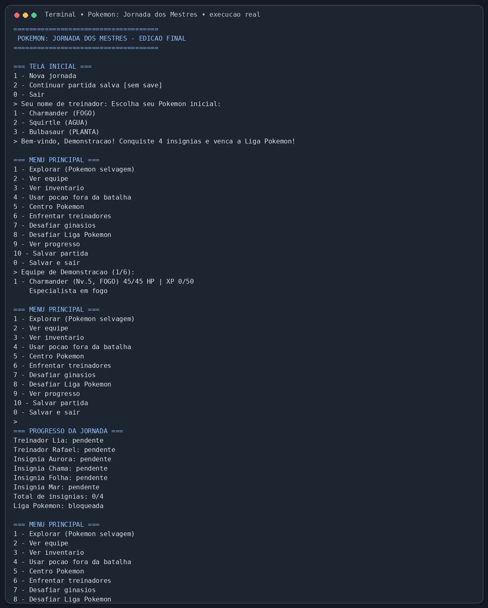
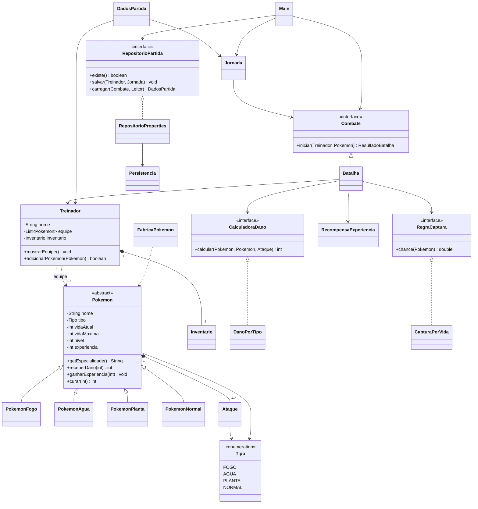

# Pokémon: Jornada dos Mestres

Projeto de RPG em console desenvolvido em **Java** para a disciplina de **Paradigmas de Programação**, com foco em Programação Orientada a Objetos (POO) e nos cinco princípios SOLID. A jornada inclui batalhas por turnos, captura e evolução de Pokémon, ginásios e a Liga Pokémon.

> Projeto acadêmico de fã, sem finalidade comercial e sem vínculo com Nintendo, Game Freak ou The Pokémon Company.

## Requisitos

- Java Development Kit (JDK) 17 ou superior.
- Nenhuma biblioteca externa é necessária.

## Como executar

**No IntelliJ IDEA:** abra a pasta do projeto em `File > Open`, selecione **JDK 17 ou superior**, abra `src/Main.java` e clique em **Run 'Main.main()'**. Marque a pasta `src` como *Sources Root* se o IntelliJ não a reconhecer automaticamente.

**No terminal (Linux/macOS):**

```bash
mkdir -p out
javac -encoding UTF-8 -d out src/*.java
java -cp out Main
```

**No terminal (Windows PowerShell):**

```powershell
mkdir out
javac -encoding UTF-8 -d out src\*.java
java -cp out Main
```

O menu oferece **Nova jornada**, **Continuar partida salva** e, durante o jogo, **Salvar partida** e **Salvar e sair**. O progresso é gravado em `save/partida.properties` relativo ao diretório em que o programa é executado. O arquivo de salvamento é mantido localmente e ignorado pelo Git.

## Mecânicas implementadas

- Escolha entre Charmander, Squirtle e Bulbasaur; batalha em turnos com vantagem entre tipos Fogo, Água, Planta e Normal.
- Seleção numerada de Pokémon antes da batalha, troca de Pokémon, fuga de selvagens, poções, Pokébolas e até seis integrantes na equipe.
- Captura com chance crescente quando o HP do alvo diminui; **captura bem-sucedida concede 50% do XP de vitória** ao Pokémon ativo.
- XP, níveis, aumento de HP e evoluções: Charmander → Charmeleon (16) → Charizard (36); Squirtle → Wartortle (16) → Blastoise (36); Bulbasaur → Ivysaur (16) → Venusaur (32).
- Centro Pokémon, treinadores Lia e Rafael, quatro ginásios sequenciais (Aurora, Brasa, Bosque e Oceano), quatro membros da Elite e Campeão Orion.
- Liga desbloqueada após quatro insígnias; confrontos consecutivos preservam o HP da equipe.
- Salvamento e recuperação de Pokémon, XP, HP, inventário, insígnias, treinadores vencidos e título de campeão.

## Imagem da execução



## Programação Orientada a Objetos

- **Abstração:** `Pokemon` é classe abstrata e define operações compartilhadas, como `receberDano`, `curar`, `ganharExperiencia` e `getEspecialidade`.
- **Herança:** `PokemonFogo`, `PokemonAgua`, `PokemonPlanta` e `PokemonNormal` estendem `Pokemon`.
- **Polimorfismo:** `Treinador` guarda uma lista `List<Pokemon>` com diferentes subclasses; `mostrarEquipe()` chama `p.getEspecialidade()` e cada subtipo fornece sua implementação.
- **Encapsulamento:** atributos privados de `Pokemon` e `Inventario`; operações públicas preservam regras de HP, XP, itens e limites da equipe.
- **Composição:** `Treinador` possui `Inventario` e uma equipe de `Pokemon`; `Jornada` guarda as conquistas e utiliza um `Combate`.

## Princípios SOLID

### S — Single Responsibility Principle (Responsabilidade Única)

- `RecompensaExperiencia.java`: calcula apenas XP de vitória ou captura, sem controlar turnos ou inventário.
- `DanoPorTipo.java`: calcula dano, sem reduzir HP nem imprimir menus.
- `CapturaPorVida.java`: determina apenas a chance de captura.
- `Persistencia.java`: representa o formato do save local; `RepositorioProperties.java` atua como adaptador para a interface de repositório.

Assim, alterar o cálculo de XP não exige alterar o sistema de armazenamento ou a regra de dano.

### O — Open/Closed Principle (Aberto/Fechado)

- `CalculadoraDano` e `RegraCaptura` definem contratos. `DanoPorTipo` e `CapturaPorVida` são implementações.
- Um novo sistema de dano (por exemplo, dano com crítico) pode implementar `CalculadoraDano` e ser **injetado no construtor de `Batalha`**, sem editar sua lógica de turnos.
- Da mesma forma, outra estratégia de captura pode implementar `RegraCaptura`.

Exemplo de implementação alternativa para o cálculo de dano:

```java
CalculadoraDano danoFixo = (atacante, defensor, ataque) -> 3;
```

### L — Liskov Substitution Principle (Substituição de Liskov)

- As quatro subclasses de `Pokemon` usam o mesmo contrato de HP, XP, evolução e batalha.
- `Treinador`, `Batalha` e `CalculadoraDano` operam com a abstração `Pokemon`, sem precisar receber um tipo específico.
- `FabricaPokemon` e `Pokemon.restaurar` constroem subclasses concretas. Assim, cada subtipo pode substituir um `Pokemon` sem criar exceções ou mudar o comportamento esperado dos métodos-base.

### I — Interface Segregation Principle (Segregação de Interfaces)

Contratos pequenos, sem métodos não relacionados:

- `CalculadoraDano`: somente `calcular`.
- `RegraCaptura`: somente `chance`.
- `RepositorioPartida`: somente operações de persistência.
- `Combate`: somente operações para iniciar batalhas.

Uma estratégia de captura não precisa implementar métodos de dano ou salvamento.

### D — Dependency Inversion Principle (Inversão de Dependência)

- `Batalha` recebe `CalculadoraDano` e `RegraCaptura` em seu construtor, em lugar de depender diretamente de implementações fixas dentro da lógica de combate.
- `Jornada` depende de `Combate`, não de `Batalha`.
- `Main` mantém uma referência `RepositorioPartida`, abastecida por `RepositorioProperties`; `RepositorioPartida` abstrai o formato de armazenamento.

As implementações concretas são conectadas no ponto de composição (`Main` ou no construtor de conveniência), de modo que regras e adaptadores podem ser trocados.

## Diagrama UML de classes

O diagrama apresenta as principais classes, interfaces e relações do sistema.



## Testes automatizados

Na pasta principal, compile os fontes e os testes:

```bash
javac -encoding UTF-8 -d out src/*.java testes/*.java
```

Para evitar sobrescrever um salvamento pessoal, execute os testes em um diretório temporário. O teste de persistência cria `save/partida.properties` no diretório de execução:

```bash
cd /caminho/para/uma/pasta/temporaria
java -ea -cp /caminho/absoluto/do/projeto/out TestesProjeto
```

Os testes verificam subclasses, polimorfismo, efetividade do dano, chance de captura, metade do XP, troca de estratégias de dano/captura e recuperação do save.

## Estrutura do projeto

```text
src/               Código-fonte do jogo
├── Main.java      Ponto de entrada da aplicação
├── Pokemon.java   Classe-base dos Pokémon
├── Batalha.java   Implementação do combate
└── ...            Outras classes e interfaces
testes/            Testes automatizados
docs/              Imagem de execução
.gitignore         Arquivos locais ignorados pelo Git
README.md          Documentação do projeto
```
